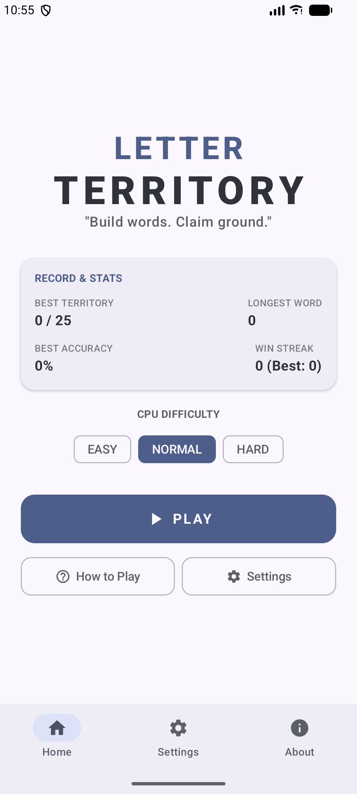
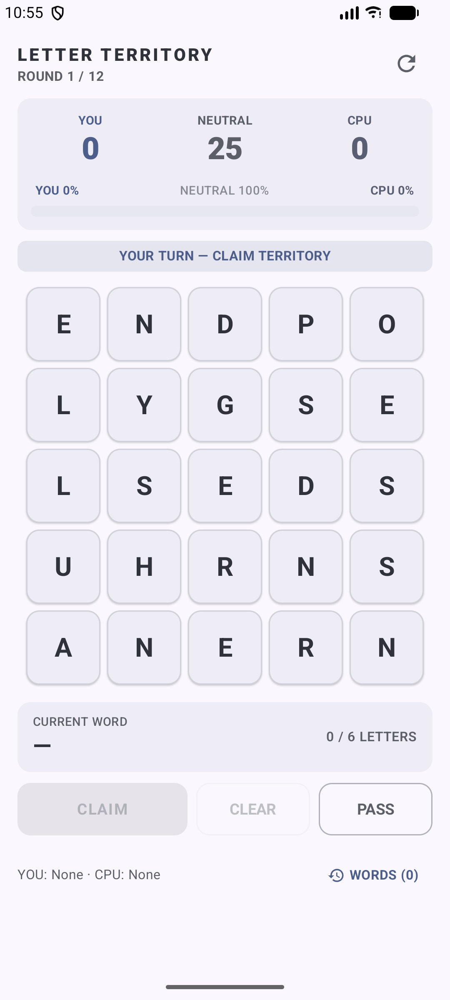
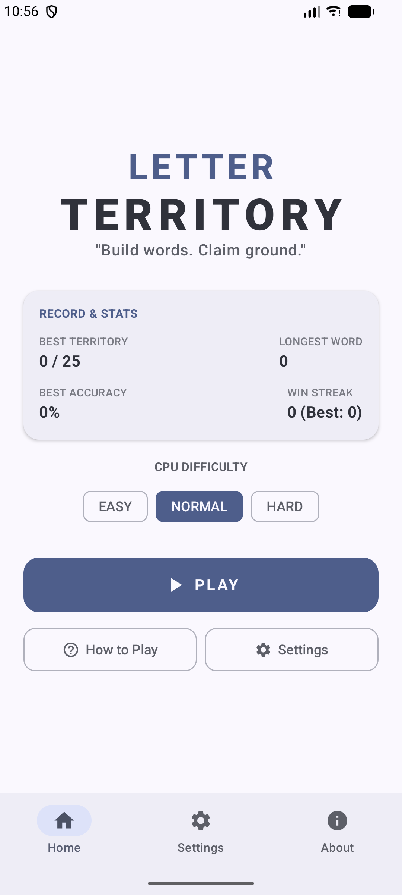

# Letter Territory 🔤🗺️

> **"Build words. Claim ground."**

**Letter Territory** is a strategic 5x5 word-building and grid-control game for Android built with modern **Jetpack Compose** and **Material 3**. Players face off against an AI opponent on a 25-cell letter grid, taking turns to construct valid words and claim territory across the board.

---

## 📸 Screenshots

| Home Screen | Gameplay | Word Selection |
| :---: | :---: | :---: |
|  |  |  |

---

## ✨ Features

- 🧩 **Dynamic 5x5 Grid Generator**: Balanced board creation using weighted letter frequencies (optimized for common English vowels & consonants) and guaranteed minimum word counts.
- 🤖 **Smart AI Opponents**:
  - **EASY**: Relaxed CPU play style prioritizing shorter 3–4 letter words.
  - **NORMAL**: Balanced CPU strategy aiming for optimal capture opportunities.
  - **HARD**: Highly competitive CPU that evaluates connectivity, neutral cell gains, and long-term grid control.
- ⏱️ **Turn Timer & Game Options**: Toggle optional turn timers (10s, 15s, or Off), diagonal cell connections, coordinate labels, and word feedback.
- 📊 **Detailed Match Statistics**: Track lifetime wins, losses, win streaks, best territory claims, longest words, and word accuracy percentages.
- 🎨 **Material 3 Design & Themes**: Supports System, Light, and Dark modes along with Android Dynamic Color integration.
- 📳 **Haptics & Sound Effects**: Tactile haptic responses and audio feedback on cell selections and territory claims.
- ⚡ **Optimized Trie Engine**: Fast on-device dictionary lookups and prefix searching for smooth performance.

---

## 🎮 How to Play

1. **Form Words**: Tap adjacent letters (orthogonally or diagonally) on the 5x5 board to construct words between **3 and 6 letters** long.
2. **Claim Ground**: Submitting a valid word captures all neutral cells used in that word's path for your side.
3. **Outmaneuver the CPU**: Block opponent paths and capture key neutral cells before the 12 rounds are up.
4. **Win the Match**: The player with the most captured territory at the end wins! In case of equal territory, tiebreakers evaluate valid word counts and total letters used.

---

## 🛠️ Tech Stack & Architecture

- **Language**: 100% Kotlin
- **UI Framework**: Jetpack Compose & Material 3
- **Architecture**: Clean Architecture / MVVM (`ViewModel`, `StateFlow`)
- **Data Persistence**: `SharedPreferences` for settings and stats
- **Data Structures**: Custom `Trie` implementation for fast $O(L)$ dictionary validation
- **Build System**: Gradle Version Catalogs (`libs.versions.toml`)
- **Min SDK**: 26 (Android 8.0 Oreo)
- **Target SDK**: 37 (Android 15+)

---

## 🚀 Building & Running

### Prerequisites
- Android Studio Ladybug (2024.2+) or newer
- JDK 11 or higher
- Android SDK 37

### Clone & Build
```bash
# Clone repository
git clone https://github.com/abdullah-ateeq/Letter-Territory.git
cd Letter-Territory

# Build Debug APK
./gradlew assembleDebug

# Run Unit Tests
./gradlew test
```

---

## 📄 License

This project is open source and available under the [MIT License](LICENSE).
